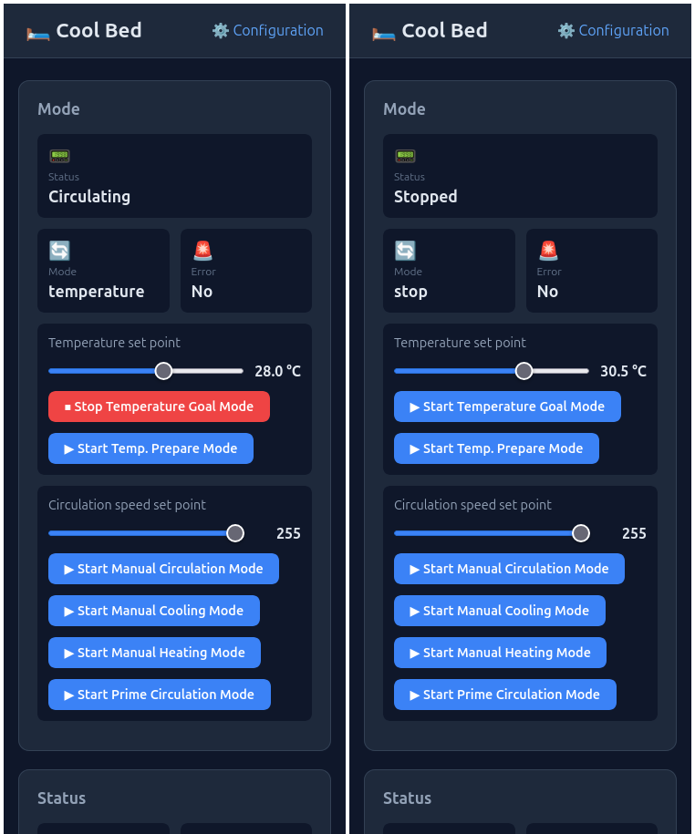

## Introduction

The controller's web interface has two pages: the **Main** page, which lets you start and stop the various Cool Bed modes, and the **Configuration** page, where you can change settings that are rarely modified.

You can switch between the pages by clicking the icons in the top-right corner of the interface.

TODO: get screen shot of the configuration page

TODO: discuss and explain the various settings and options.