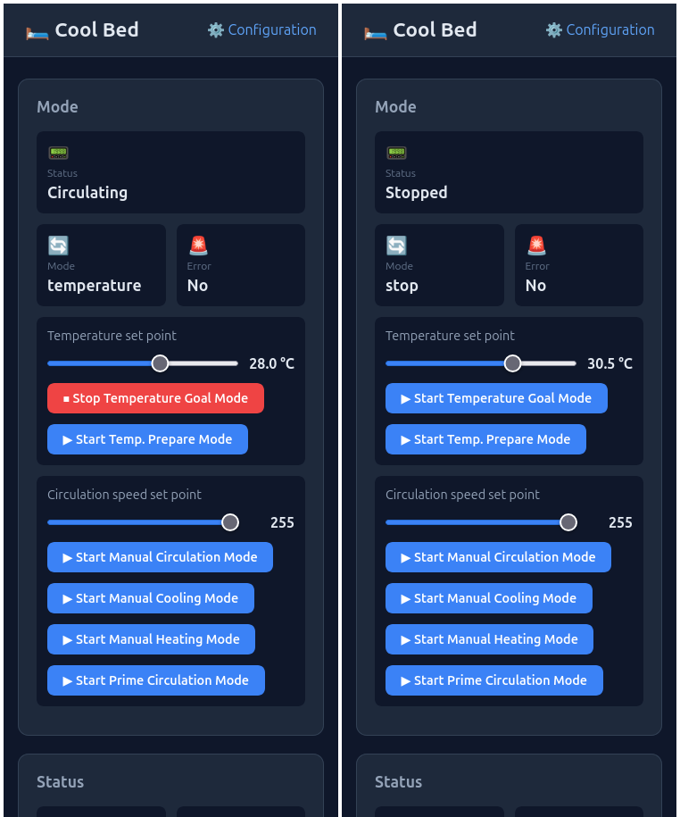

## Introduction

This section explains how to flash the controller with the firmware—in other words, how to install the software that runs the Cool Bed device.
If this is your first time flashing a microcontroller, don't worry. Follow the instructions below, ask an LLM for help, or post a question in the [Discussions](https://github.com/ayavilevich/cool-bed-firmware/discussions).

## TL;DR for experienced users

* The firmware source code is available at [https://github.com/ayavilevich/cool-bed-firmware](https://github.com/ayavilevich/cool-bed-firmware).
* Use PlatformIO to build and upload the firmware.
* Optionally, create a local `platformio.local.ini` file to customize settings.
* Optionally, add a PlatformIO Project Environment for a custom build or a custom controller board.
* After flashing, connect to the "cool-bed" Wi-Fi access point to configure Wi-Fi. Once connected to the access point, Wi-Fi Manager's IP is [http://192.168.4.1](http://192.168.4.1).
* Once Wi-Fi is configured, access the controller at [http://cool-bed.local](http://cool-bed.local) or by using its IP address.

## Dependencies

Cool Bed Firmware is built using [PlatformIO](https://platformio.org/) and the Arduino framework. PlatformIO is an extension for [Microsoft Visual Studio Code](https://code.visualstudio.com/). The software stack and tools are multiplatform and open source.

If you don't have it, [install VS Code](https://code.visualstudio.com/Download).

Then follow the instructions to [install PlatformIO](https://platformio.org/install/ide?install=vscode).

PlatformIO will take care of all other dependencies, such as SDKs and libraries.

## Getting the software

The controller's firmware source code is available at [https://github.com/ayavilevich/cool-bed-firmware](https://github.com/ayavilevich/cool-bed-firmware).

If you are comfortable with Git, use `git clone https://github.com/ayavilevich/cool-bed-firmware` to clone the repository into a local folder. This will be more convenient if you later want to update your copy or contribute to the project.

If you're not familiar with Git, you can download the project as a [ZIP file](https://github.com/ayavilevich/cool-bed-firmware/archive/refs/heads/main.zip) directly from GitHub].

There are currently no prebuilt firmware binaries available, so you'll need to build the firmware from the source code.

Start VS Code and open the project folder. Make sure you open the folder containing the file `platformio.ini`. The first time you open the project, PlatformIO may install dependencies and process the configuration. Wait for it to finish.

## Customizing the software

The firmware is flexible and supports various [controller boards](../components/controller-board.md) and [component](../builds.md) configurations.
In this guide, a **build** refers to a specific hardware configuration: a particular controller board and the components connected to it.
For each build, the project defines one or two "PlatformIO Project Environments". One environment is used to upload the firmware over USB, while the other, which is optional, is used for over-the-air (OTA) updates over Wi-Fi.
The project comes with a couple of predefined builds. If you plan to use one of the predefined builds without OTA, then skip to the next section.

To customize the software, make a copy of `platformio.local.sample.ini` named `platformio.local.ini`. This creates a local configuration file containing overrides for the predefined settings.
In the local INI file, change the OTA password and any other settings you need to customize.

To configure a custom build, copy the environment block from `platformio.ini` that most closely matches your hardware. Paste it into the local INI file and modify it to create a new environment with a unique name.
Here, you can enable or disable optional components, change pin assignments, and more.

## Building the software

With the project folder open in VS Code, press F1 and select **PlatformIO: Pick Project Environment**. Select the environment you want to use and wait for PlatformIO to process the change.

Next, press F1 and select **PlatformIO: Build**. You can also start the build using another method supported by PlatformIO. If everything is configured correctly, the project should build successfully.
If you encounter problems, ask for help in [Discussions](https://github.com/ayavilevich/cool-bed-firmware/discussions). Include as much relevant information as possible, such as the build log and a description of any customizations you've made.

## Connecting the controller to a computer

An ESP32 controller communicates with the computer over a serial connection via USB.
Check whether your [controller board](../components/controller-board.md) supports serial communication over USB.
Some boards use USB for power only, not for data. Check your board's specifications to be sure.
If your board doesn't support serial communication over USB, you'll need an external ["USB to TTL serial adapter"](https://www.youtube.com/watch?v=04ZXbOpQt9s).
The adapter connects to the computer via USB and to the controller board via its RX, TX, and GND pins. 
Some adapters also provide a power connection. 
Usually, you won't need to use the adapter's power connection. Instead, power the board using its normal power supply or power connector.

Once the controller board is connected to the computer via its built-in USB interface or an external USB-to-UART adapter, it should appear as a serial port.
If you're unsure how to verify the connection, ask an LLM to guide you through checking the serial port on your operating system.
One way to get a list of available ports is to use the **PlatformIO: Set Project Port** command.
Another way to check the connection is to run **PlatformIO: Serial Monitor** and see whether it connects successfully.
Once the serial monitor is connected, reset the controller to see its startup output and monitor the boot process.
Note that 115200 baud is a common serial connection speed.

## Flashing the controller

With the controller properly connected and detected by the computer, use the **PlatformIO: Upload and Monitor** command to flash the firmware and monitor the controller's output.

## Configuring and testing the controller

The first time you start a Cool Bed controller, it won't have any Wi-Fi settings configured.
The controller will create an open Wi-Fi access point called "cool-bed" with no password.
Connect another device to this access point. Stay connected even if your device warns you that the network has no internet access.
If you're not automatically redirected to the configuration page, open a browser and navigate to [http://192.168.4.1](http://192.168.4.1).
The Wi-Fi configuration page should open. Enter the SSID and password of the Wi-Fi network you want the controller to connect to.

Once the controller connects to your Wi-Fi network, you can access its web interface from another device on the same network.
By default, the controller is accessible at [http://cool-bed.local](http://cool-bed.local).
If `cool-bed.local` doesn't work, the controller's IP address will be printed over the serial connection.
You can find the IP address in the serial monitor or in your router's administration interface.

When you open the web interface, you should see a page similar to this:

Try starting and stopping a few manual modes to check that the system responds as expected.

Once the software is running and responding as expected, move on to the next steps.  
Power down the controller and assemble the [rest of the system](loops.md), including the sensors, pumps, and other components.  
You can open the controller's [Configuration](configuration.md) page by clicking the link in the top-right corner of the Main page.
