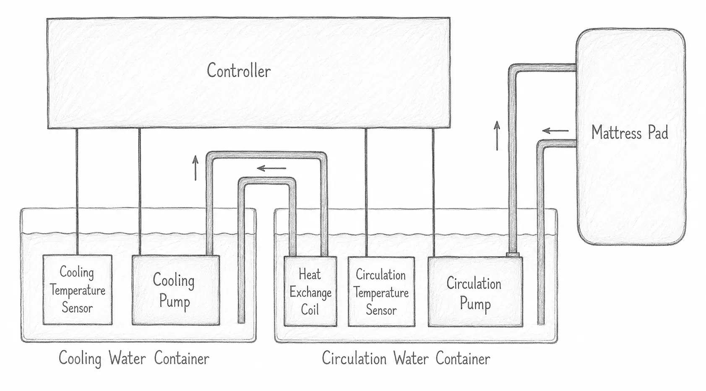

Flash the [firmware](firmware.md) on the controller and test it before connecting it to the other components.

Connect the various components as shown in the diagram:

Add any optional components you choose to use.

Important notes:

* Disconnect the device from the [power supply](../components/power-supply.md) before making any changes.
* Position the [pump](../components/pumps.md) in the container with its inlet facing upward. This makes it easier for trapped air to escape from the pump and the loop.
* Only power the pumps when they are fully submerged in water or coolant.
* You can use tap water initially, but switch to [distilled water](../components/coolant.md) as soon as possible.
